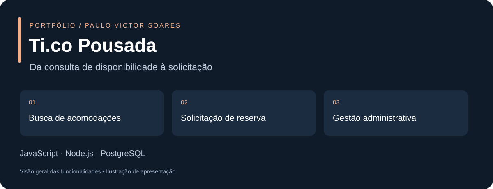

# Ti.co Pousada



Aplicação web para pesquisar acomodações e enviar solicitações de reserva, com APIs de servidor e painel administrativo. O fluxo separa o pedido do hóspede da confirmação da pousada.

**[Abrir aplicação](https://tico-seven.vercel.app)** · [Código](https://github.com/paulovctxr/tico)

> Endereço publicado no repositório. Uma solicitação enviada pode gerar um registro real: use um ambiente próprio de desenvolvimento para testes completos. A imagem acima é uma apresentação ilustrada do fluxo.

## Funcionalidades

- Seleção de chegada, saída e ocupação por acomodação.
- Consulta de disponibilidade e valores estimados.
- Solicitação de até cinco acomodações com protocolo de grupo.
- Histórico recente de buscas no navegador.
- Painel para administração de unidades, tarifas, bloqueios e solicitações.
- Validações de datas, hóspedes e entradas na API.

O envio do pedido **não confirma a reserva nem bloqueia a unidade**. A confirmação administrativa realiza esse bloqueio. Não há pagamento online nem sincronização de inventário com Booking/Airbnb. Cupons são encaminhados para análise manual.

## Tecnologias

HTML, CSS e JavaScript na interface; Node.js nas APIs; Supabase Auth e PostgreSQL para autenticação e persistência. Publicação com Vercel e testes com Node Test Runner.

## Executar e testar

Pré-requisitos: Git, Node.js 22 ou superior e um projeto Supabase de desenvolvimento para o fluxo completo.

```sh
git clone https://github.com/paulovctxr/tico.git
cd tico
npm test
```

O script de testes usa `node --test tests/*.test.mjs`. A execução não substitui a validação de uma instalação real do banco.

### Prévia estática

Com Python 3 instalado:

```sh
python3 -m http.server 8000 --directory public
```

Abra `http://localhost:8000`. Esse servidor permite visualizar a interface, mas **não executa as APIs Node.js**; consulta e cadastro exigem o ambiente completo.

### Aplicação completa

1. Para um **novo banco de desenvolvimento**, aplique `schema.sql` e depois `group-reservations.sql`. No banco existente do Tico, não repita o schema: consulte [LEIA-ME-PUBLICAR.md](LEIA-ME-PUBLICAR.md) e [STATUS-BANCO.md](STATUS-BANCO.md).
2. Configure as variáveis abaixo no servidor. Para desenvolvimento local com Vercel CLI, use seu ambiente de desenvolvimento, conforme a configuração da CLI.

| Variável | Finalidade |
| --- | --- |
| `SUPABASE_URL` | URL do projeto Supabase |
| `SUPABASE_PUBLISHABLE_KEY` | Chave pública do mesmo projeto |
| `SUPABASE_SECRET_KEY` | Chave secreta, exclusivamente no servidor |
| `HOTEL_ID` | Identificador da propriedade; nesta instalação, `tico-pousada` |

3. Autorize o administrador e configure unidades conforme [CONFIGURAR.md](CONFIGURAR.md).
4. Use a Vercel CLI para executar as funções localmente (`vercel dev`) ou publique em um projeto de desenvolvimento Vercel.

Na publicação, mantenha **Framework: Other**, **Output Directory: public**, e comandos de build e instalação vazios, conforme `vercel.json`. Envie também `api/` e `lib/`, não apenas os arquivos HTML.

## Roteiro de demonstração

1. Consulte datas e ocupação e veja as opções retornadas.
2. Explore o resumo de uma acomodação.
3. Em ambiente de desenvolvimento, envie uma solicitação fictícia e confira o protocolo.
4. Com usuário autorizado, consulte o pedido no painel e explore confirmação/cancelamento.

## Organização do código

- `public/`: interface publicada e imagens.
- `api/reservations.js`: consulta e criação de solicitações.
- `api/admin.js` e `api/login.js`: funções administrativas e autenticação.
- `lib/server.js`: configuração, acesso ao banco e autorização.
- `lib/validation.js`: regras de entrada.
- `tests/`: testes de API e validação.
- `schema.sql` e `group-reservations.sql`: estrutura do banco e reservas em grupo.

## Documentação operacional

- [Publicação e escopo dos recursos](LEIA-ME-PUBLICAR.md)
- [Configuração do administrador](CONFIGURAR.md)
- [Estado e cuidados com o banco](STATUS-BANCO.md)

As instruções existentes de operação foram preservadas. Esta documentação não afirma que uma nova rodada de testes ou uma nova publicação da aplicação tenha sido executada.
